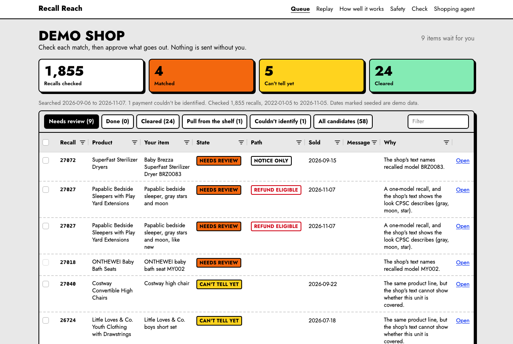
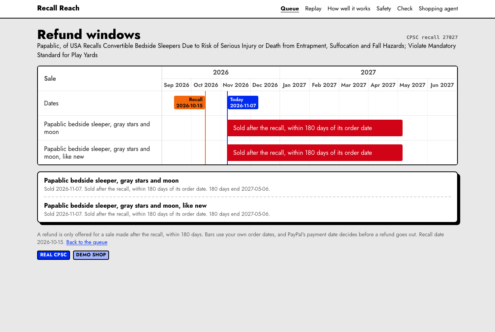
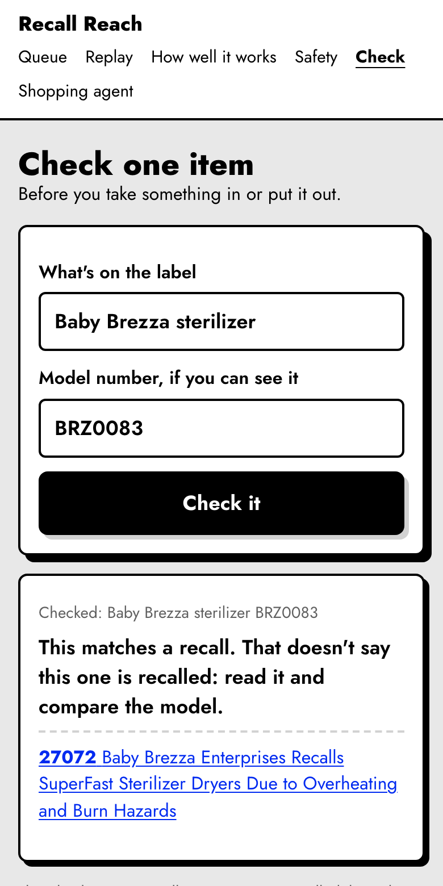
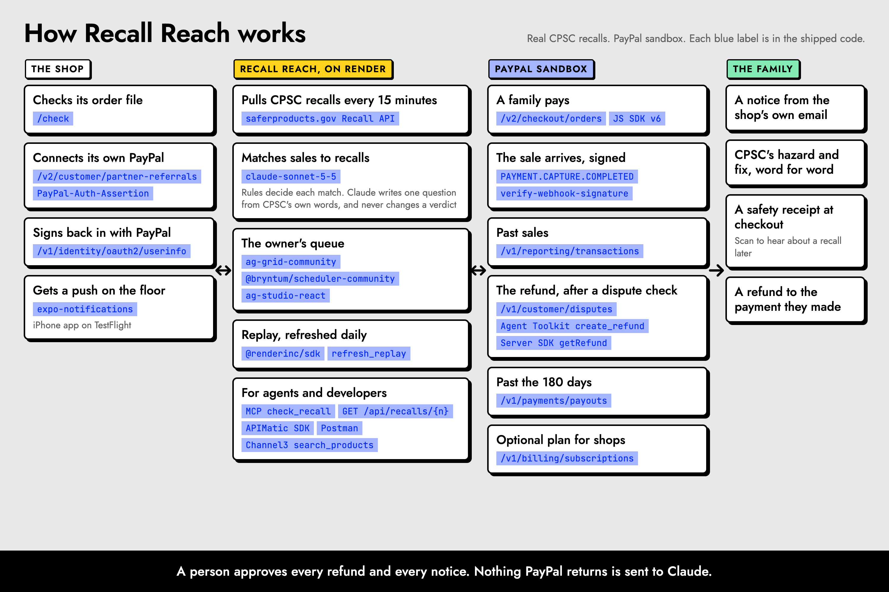

# Recall Reach

When a baby product gets recalled after a small resale shop sold it, Recall Reach finds the order, helps the shop reach the family, and refunds the sale through PayPal when the sale came after the recall.

**Try it, no login:** https://recall-reach-web-e022.onrender.com/judge



Built for the PayPal AI Hackathon, November 2026. The recalls are real CPSC records. The shop is a demo, labelled as one, and its payments are real PayPal sandbox payments. No real shop or family has used this yet.

## What it does

1. **Checks past sales against real recalls.** It pulls recalls from CPSC every 15 minutes and checks each shop's order lines against them with rules, in the app. A shop that uploaded before a recall came in gets that recall on its next visit from the same browser.
2. **Says when it can't tell.** Most recalls cover certain models, dates or versions, and an order line rarely says which one it was. Those read "Can't tell yet", never a false "not recalled".
3. **Asks the family what the recall needs.** Claude writes one question resting on words CPSC really wrote, and the check rejects a question whose quote isn't in the record. The owner approves it before it goes out.
4. **Leaves every message and refund to a person.** The owner approves it, the notice opens in the shop's own mail, and they send it. The family answers on a phone page, and the seller's card changes.
5. **Refunds only what it should.** A sale after the recall date, within 180 days of the payment, for the exact amount the owner approved. The demo shop's refund goes through PayPal Agent Toolkit with one request id, and the page reconciles our record against PayPal's refund, PayPal's payment and the webhook.


A sale's 180 days, against the recall date and today, on the demo shop:



Checking one item at the counter, on a phone:



## See it for yourself

On `/judge`, "See PayPal refuse a late refund" sends PayPal's sandbox test header (`PayPal-Mock-Response`, `REFUND_TIME_LIMIT_EXCEEDED`) with a one-cent refund on a recent sandbox sale that PayPal itself reports as fully refunded, so no money can move, and it changes no records here. It picks that sale from our refund records, which the 46-hour purge empties, so run the refund step first.

| Page | What it shows |
|---|---|
| [`/judge`](https://recall-reach-web-e022.onrender.com/judge) | A numbered route through all of it |
| [`/replay`](https://recall-reach-web-e022.onrender.com/replay) | Every recall from 2025 on, checked against the demo shop in one run, with a clock and a link to recount it |
| [`/eval`](https://recall-reach-web-e022.onrender.com/eval) | Held-out numbers beside a word-match baseline, with intervals and their limits |
| [`/safety`](https://recall-reach-web-e022.onrender.com/safety) | Five attacks tried against the real code |
| [`/evidence/paypal`](https://recall-reach-web-e022.onrender.com/evidence/paypal), [`/evidence/ag-grid`](https://recall-reach-web-e022.onrender.com/evidence/ag-grid) | Each claim, and the file that does it. A test fails if the code leaves that file |
| [`/evidence/defects`](https://recall-reach-web-e022.onrender.com/evidence/defects) | Defects we found in our own work, what changed, and how it was checked again |
| [`/r/sample`](https://recall-reach-web-e022.onrender.com/r/sample) | What a family sees for a real recall, as a labelled sample that stays up |
| [`/check`](https://recall-reach-web-e022.onrender.com/check) | One item typed in at the counter. A shop's own order file or a Shopify store's public listings, deleted on request or after 7 days, or kept while the owner signs in with PayPal at least once a year |
| [`/shopper`](https://recall-reach-web-e022.onrender.com/shopper) | A shopping agent that searches public listings through Channel3 and has to check one against CPSC recalls before it may offer it. A person approves on PayPal's page, in the sandbox |
| [`/status`](https://recall-reach-web-e022.onrender.com/status) | Each outside service's last reading, and what that reading measures |
| [`/privacy`](https://recall-reach-web-e022.onrender.com/privacy) | What is kept, and text a shop can copy |

[Android build](https://recall-reach-web-e022.onrender.com/get/android): queue only, push is iPhone only, not tested on a device.

[iPhone build](https://recall-reach-web-e022.onrender.com/get/ios), on Apple TestFlight (passed Apple's beta review Nov 6, 2026): a web view of the live queue. A push reached a real iPhone on TestFlight on Nov 8, 2026, and tapping it opened the card.

From a terminal:

```bash
curl https://recall-reach-web-e022.onrender.com/api/health
curl "https://recall-reach-web-e022.onrender.com/api/recalls/today/matches?shop=demo"
curl "https://recall-reach-web-e022.onrender.com/api/check?title=Baby%20Brezza%20sterilizer&model=BRZ0083"
curl "https://recall-reach-web-e022.onrender.com/api/recalls/27072"
```

`/api/health` also lists each outside service under `integrations`: an id, a name, a mode (`live`, `fallback`, `off`, or `client` for what only runs in the browser), a line of detail and when it was checked. A row says `live` only after its own check passed.

API docs, with a TypeScript SDK, generated by APIMatic from [`openapi.yaml`](openapi.yaml) and served from this site: [`/api-docs`](https://recall-reach-web-e022.onrender.com/api-docs). The SDK is in [`sdk/typescript`](sdk/typescript), and `pnpm exec tsx scripts/sdk-live.ts` calls the deployed site through it. A test checks its models read what the real routes answer. The docs' Send button runs a check against the deployed site.

Or run the public API with its checks, against the deployed site: `pnpm dlx newman run postman/recall-reach.postman_collection.json`. It's in [`postman/`](postman/), and it writes nothing. The same collection is public in Postman, no login needed: [Recall Reach public API](https://www.postman.com/stephensook-9992516/recall-reach/collection/60034350-b3303ddb-0026-4004-92ba-a40427cef179), in the [Recall Reach workspace](https://www.postman.com/stephensook-9992516/recall-reach).

Newman runs this collection against the live site twice a day ([`.github/workflows/newman.yml`](.github/workflows/newman.yml)), and the job fails if fewer than 10 requests or 26 assertions ran or any failed.

A recall's sales are drawn on a [Bryntum](https://bryntum.com/products/scheduler/) timeline, reached from a sale's card in the queue. Each bar is a sale's 180-day refund window, from the shop's own order date, with lines at the recall date and today, so you can see why a sale gets a notice, a check or a refund. PayPal's own payment date still decides before a refund goes out. "Plan follow-ups with Claude" adds a dashed follow-up to each sale whose family hasn't been reached, and flags any with under a week of refund window left instead: Claude reads only CPSC's public text for the recall and says how soon the hazard warrants one and how severe it is, resting on CPSC's own words. The page shows a fixed sentence for that severity, so nothing Claude writes reaches the owner as advice. It never sees a sale. Code sets each date, at least a week before an open refund window ends and within 30 days otherwise, the owner confirms or drags it, and nothing is sent: it's a reminder on the owner's timeline and queue card.

Each recent recall's product name also goes to [Channel3](https://recall-reach-web-e022.onrender.com/evidence/channel3), from the hourly job, to see what the market lists under it. A page like [`/sweep/27072`](https://recall-reach-web-e022.onrender.com/sweep/27072) shows same-brand, same-product results as candidates for a person to review. None is called recalled, and no seller is kept. Only CPSC's public words go out.

For agents and marketplaces, the same check is an MCP tool, `check_recall`, on [`/api/mcp`](https://recall-reach-web-e022.onrender.com/evidence/api), with `get_recall` beside it to read one recall by its number. A result names a recall to read, not a finding about the item. No key, and nothing sent is stored. The API is described in [`openapi.yaml`](openapi.yaml), and a test checks it against the code.

```bash
claude mcp add --transport http recall-reach https://recall-reach-web-e022.onrender.com/api/mcp
```

```json
{ "mcpServers": { "recall-reach": { "type": "http", "url": "https://recall-reach-web-e022.onrender.com/api/mcp" } } }
```

## The PayPal calls

Sandbox only. [`/evidence/paypal`](https://recall-reach-web-e022.onrender.com/evidence/paypal) checks these against the code.

Real shops can optionally subscribe to "Recall Reach for shops" through PayPal Subscriptions during the hackathon: PayPal sandbox, no real charge. Families never pay. Everything that keeps families safe stays free: recall checks, notices, safety receipts and refunds. The price is set once in `SHOP_PLAN` in `server/paypal/subscriptions.ts`. Run `pnpm exec node --import tsx scripts/subscription-plan.ts` once with the sandbox app credentials, save its printed `PAYPAL_SUBSCRIPTION_PLAN_ID` in the host environment, and subscribe that app's webhook to `BILLING.SUBSCRIPTION.ACTIVATED`, `.CANCELLED`, `.SUSPENDED` and `.EXPIRED`. Without a plan id the owner sees that subscriptions are not set up. Raw subscription ids (encrypted at rest) and PayPal status facts are purged at 46 hours; after that, cancellation needs the id from the owner's PayPal sandbox account. Deleting the shop, including its automatic deletion after 7 days with no linked PayPal login or a year with no sign-in, does not cancel the subscription at PayPal, so cancel it first. A sandbox subscription ran on Nov 8, 2026: PayPal reported it ACTIVE, and its activation webhook arrived and passed PayPal's own check.

| PayPal | What it does here | File |
|---|---|---|
| `GET /v1/reporting/transactions` (Transaction Search) | Finds a shop's sales near a recall, read again on every run | `server/paypal/transactions.ts` |
| `POST /v2/checkout/orders`, then capture and `GET` (Orders v2) | Makes the demo shop's sandbox sales and reads them back | `server/paypal/orders.ts` |
| `GET /v2/payments/captures/{id}` (Payments) | Reads a payment before anything is refunded | `server/paypal/orders.ts` |
| `GET /v1/customer/disputes` (Customer Disputes) | Holds a refund if the payment has a dispute | `server/paypal/disputes.ts` |
| `create_refund` (Agent Toolkit), which calls `POST /v2/payments/captures/{id}/refund` | Sends a refund the owner approved, from the app's own code | `server/paypal/toolkitRefund.ts` |
| `GET /v2/payments/refunds/{id}` (Server SDK `getRefund`) | Reads the refund back so the records can be compared | `server/paypal/sdkRefundRead.ts` |
| `PAYMENT.CAPTURE.COMPLETED` (webhook) | Tells the queue a sale happened, once its signature is verified | `server/paypal/webhookHandler.ts` |

## Who can move money

The demo shelf also has PayPal's JS SDK v6 button, wired to `/api/demo/buy/paypal/sdk` and `/api/demo/buy/paypal/sdk/capture` through the same order and capture helpers as the PayPal-login path. It appears only after the sandbox SDK loads and reports PayPal eligible. A person paid through it in a real browser on Nov 8, 2026: PayPal's popup, approval, one capture, and the card on the queue 15.8 seconds after the capture. The two existing buy buttons remain available.

| Who | What they can do |
|---|---|
| The owner | Review a refund, then confirm its exact amount: two clicks, for a sale after the recall date and inside 180 days |
| Claude | Nothing. It reads recall text, the shop's own titles and, on `/shopper`, public listing titles. A test fails if any tool it's offered has a field for an amount, currency, capture, refund or payee |
| A person on `/shopper` | Approve one sandbox test order on PayPal's page, at the price the server read from the listing. Nothing ships and no store is paid |
| A family | Answer on their phone page. That changes the seller's card, and moves no money |

## What's live and what's demo

| Live | Demo, and labelled so on screen |
|---|---|
| CPSC recalls, read from CPSC's API | The demo shop, its titles and its sale dates |
| PayPal's sandbox API, with real calls | All money: sandbox only, nothing real moves |
| Claude's check and written questions | |
| Channel3's market search | |

## What stays where

- **Nothing PayPal returns goes to Claude or any other third party.** Claude reads CPSC's public text, the shop's own item titles and, on `/shopper`, public listing words. Sales join to those items in the app, by order number, SKU or exact title. Tests plant PayPal values in the database and check they are in no request Claude would receive. They stop at the wire: they read what the SDK would send, and make no network call.
- **Built to follow PayPal's 48-hour deletion rule.** PayPal-sourced rows are purged hourly at 46 hours, and a test fails if a PayPal-sourced table isn't on that list.
- **The app never emails anyone.** Messages open in the shop's own mail.
- **A shop's buyer emails are encrypted**, and a file is deleted on request or after 7 days. An owner who links a PayPal login keeps the shop and its file until they delete it, or a year passes with no sign-in. Only an HMAC of the PayPal account id is kept.
- **Safety receipts let a family opt in at checkout.** A shop's queue has a printable QR and signed link. The family gives the tag words and an email, then bookmarks the delete link shown on screen. Receipts use the existing queue and owner-approved mail flow, with no refund authority. A receipt is deleted when the family or the shop deletes it, after at most 3 years, or with the shop's data: 7 days after a real shop joined, or a year after the last PayPal sign-in for a shop whose owner signs in at least once a year, within 48 hours for a demo shop. The receipt page and the queue show the exact date. Family data stays out of Claude and Channel3.

### Every call to Claude

| Call | What Claude gets | What it can't touch | If Claude is down |
|---|---|---|---|
| Check with Claude, on a card | CPSC's recall text, and the shop's own titles, SKUs and listing descriptions | A verdict, a notice, a refund, anything from PayPal | The card stays as it was and says so |
| The question for a family | One recall's text from CPSC | A sale, a shop, a family. The question is used only while the words it rests on are in CPSC's record | A family gets CPSC's model numbers or a plain question |
| The shopping agent | What the person typed, public listing titles and brands with any price taken out, and the recalls its check found | A price, an order, PayPal | The page says the agent isn't available |
| The daily call | "Say ok." | Everything | `/status` shows the last good answer getting older |

All but the daily call start on `claude-sonnet-5-5` and fall back to `claude-haiku-5-5` when the main model is down. The daily call asks both, so `/status` can show the main model stopping. Matching, notices and refunds don't need Claude: without it, the rules still run and the app still works. What Claude adds is a reading of a card a person would otherwise read alone, a question specific to one recall, and a shopping agent that checks first.

## Limits

- A shop is checked when a recall first appears. Later edits to that recall don't re-run it.
- Shops are checked against CPSC recalls from 2022 on. The queue says the real number and dates it checked, and names any year that didn't load.
- The matcher reads words. It can't see a label on a real product, so a look-alike can still reach a seller as a card to review.
- `/eval`'s labels were written by Claude and aren't independent. The page says so.
- Sandbox PayPal only. A real shop's file alone can't refund. A refund goes from the shop's own PayPal account, only once PayPal says it's connected and the latest read of its sales covered every window. A sandbox refund from a connected shop's own account ran end to end on Nov 8, 2026: PayPal reported the refund COMPLETED and the payment REFUNDED, and its refund event arrived and passed PayPal's own check. That seller is our own sandbox account, and the event came through that account's webhook. The platform app's webhook received none, so another connected seller's refund page may show the event as not yet.
- A refund already being sent can still finish if, at that moment, its owner presses Disconnect or a new read of the shop's sales stops partway. Stopping it would mean holding a database transaction open across PayPal's reply, which breaks how the ledger survives a crash. Disconnect says so, and PayPal's own permission stays until the seller removes it in PayPal.
- The store address on `/check` reads Shopify's public `/products.json` only, so it sees what's listed today and no sales. Its results say "need a check". A listing can't confirm a recall.
- This checks CPSC recalls. Car seats are recalled through NHTSA, so check nhtsa.gov/recalls.
- Tested on demo data and public listings. No real shop has run it yet.
- A second notice, offered 3 days after a sent notice gets no answer, is tested but never seen live: a demo shop is deleted at 48 hours, and it has no shorter clock.
- `/shopper` reads a listing's words. A match is about those words, not a finding that the item is recalled, and no match doesn't mean it's safe. Listings change, so a run isn't a fixed result. The listings seen so far are new goods, not secondhand.
- The shopping agent checks a listing's words against CPSC recalls before it may offer it. Three shapes can still be offered: a recall from the listing's maker that doesn't list everything it covers and shares no product word with the listing, because holding those would block that maker's whole range; a product sold under a brand other than the recalling firm's name, such as PACEARTH from Pacearth Direct; and a kind of product named only in the recall's description, not in its product name.

## What the real sandbox did

Measured on PayPal's sandbox, each with its date. The app is built around these, not around what a doc led us to expect.

Where each number in the film and the write-up comes from: [`docs/SOURCES.md`](docs/SOURCES.md).

- **Nov 5, 2026.** Repeating a refund with the same `PayPal-Request-Id` returned the first refund, HTTP 200 with the same id, so nothing was paid twice. A new request id on a fully refunded payment was refused: HTTP 422, `CAPTURE_FULLY_REFUNDED`.
- **Nov 6, 2026.** Sent again 6.11 hours later, the same request id still returned the first refund, and the total refunded didn't move. One read, on the sandbox. PayPal's docs say only "for a period of time", so the app stops asking again at 6 hours.
- **Nov 5, 2026.** A new sale wasn't in Transaction Search right after it was made: 0 rows. It was there when read again about 213 minutes later. PayPal documents up to 3 hours. So a shop can't find its newest sales, and the demo reads an older pool of real sandbox sales for its history.
- **Nov 6, 2026.** `custom_field` came back on no Transaction Search row, even for a payment that set `custom_id`. So the app links sales by invoice id or SKU.
- **Nov 6, 2026.** Read at 17:52 UTC, `/v1/reporting/balances` answered with an `as_of_time` of 12:59:59 UTC, about 5 hours old. A balance read isn't the balance right now.
- **Nov 7, 2026, UTC.** Asked through PayPal's resend API, a real refund event arrived again with a new transmission id. It was recorded as a duplicate: the count of events stayed at 690 and the refund's row didn't change.
- **Nov 6, 2026.** From 17:37 UTC, refunds of $30 and up answered `PENDING` with reason `ECHECK`, including calls with no app code in the way. Refunds of $1, $5 and $20 completed. On Nov 7 a payout from the same account came back `INSUFFICIENT_FUNDS` while its balance report showed $55,956.00, so its real balance looked empty. On a second sandbox account with a funded balance, refunds complete, and the site runs on that account since Nov 7. See `/evidence/defects`.

## How it's built



Next.js (App Router) and TypeScript, Postgres on Neon, hosted as one Render web service. AG Grid Enterprise for the queue and Recall Replay (trial licence through Dec 9, 2026, after which AG's watermark can show) and the free edition on the eval page. `claude-sonnet-5-5` with `claude-haiku-5-5` as its fallback, through the Anthropic SDK. `@paypal/agent-toolkit` for the refund. Vitest for unit and database tests (Postgres runs in-process through PGlite), Playwright for the golden path on the deployed site.

The one background job (`instrumentation.ts`) asks CPSC for recalls every 15 minutes. It touches the database only when the answer changes or on the hourly heartbeat, because a query every 15 minutes would keep a free-tier database awake around the clock.

## WebMCP on the shopper page

`/shopper` registers `search_listings`, `check_recall`, and `start_checkout` on
`document.modelContext` when it has `registerTool`, and otherwise on `navigator.modelContext`, for clients
that still offer only that. The Agent tools panel says which one each call came through. The existing form also works without WebMCP. Listings and prices come from Channel3, recalls
from CPSC. The buyer reviews and approves on PayPal's sandbox page. PayPal responses
stay in the browser's checkout handoff and never enter a tool result or the call log.

To enable an origin trial, register the exact origin
`https://recall-reach-web-e022.onrender.com` in Chrome's origin-trial console. Set the
returned token as the server environment variable `WEBMCP_ORIGIN_TRIAL_TOKEN` on the
Render web service, then redeploy. Only `/shopper` emits the origin-trial meta tag, and
only when this variable is set. Never commit the token. A different origin needs its
own registration. Trial enrollment and browser support still need live verification.

For ChatGPT desktop, open Settings > Browser > Enable site tools, switch to Work mode (Chat mode can't use site
tools), then open `/shopper` in its browser. If the browser blocks the new tab, the tool answers that PayPal's page is opening in this tab, and
moves this tab there a moment later. A cancel after that answer doesn't stop the move, because the call is over and a
client may cancel as cleanup; moving there moves no money, since the buyer still approves on PayPal. A newer search
before the move does stop it, and the Agent tools panel says so.
Ask it to find a listing, check it, and start checkout; the buyer approves on PayPal.
An unknown listing has no recall number to report, so it is refused with an empty
recall list. A matched listing reports the actual CPSC number and title.

The API shape was checked against the [Nov 9 WebMCP draft](https://webmachinelearning.github.io/webmcp/)
and [Chrome's imperative API guide](https://developer.chrome.com/docs/modern-web-guidance/guides/webmcp/agentic-javascript-tools):
`document.modelContext.registerTool(tool, { signal })`, JSON Schema `inputSchema`,
`execute(input, { signal })`, and cleanup by aborting the registration signal.
`provideContext()` is removed; Chrome's guide records `navigator.modelContext` as
deprecated in Chromium 150. This implementation tries the current document API first,
and falls back to `navigator.modelContext` with the same call shape. Mocked registration tests do not establish native
Chrome 149 or ChatGPT desktop compatibility. Run the tools there before claiming it.

## Run it locally

To check the code you need no keys, no accounts and no database, only Node 22.12 or newer, pnpm 10 and `openssl`. Postgres runs inside the tests.

```bash
pnpm install
pnpm test    # about 2 to 3 minutes, 2,000+ tests
pnpm eval    # recomputes /eval's numbers from the stored verdicts, in seconds
```

To run the site yourself you also need a Postgres database and sandbox keys:

```bash
pnpm install
cp .env.example .env.local     # then fill in sandbox values
pnpm db:migrate                # apply db/migrations to DATABASE_URL
pnpm load:recalls 2022 2023 2024 2025 2026
pnpm dev                       # http://localhost:3000
```

`.env.example` lists every variable and what reads it. Secrets stay in macOS Keychain or the host's secret store, never in the repo.

## Tests

```bash
pnpm lint && pnpm typecheck && pnpm test && pnpm build   # what CI runs, with a gitleaks scan of the full history
pnpm exec playwright test --config playwright.webmcp.config.ts  # local browser smoke, mocked document tools and PayPal; build first
pnpm eval                                                # recomputes eval/results.json
EXPECT_BUILD=<short commit> pnpm test:golden            # the golden path on the deployed site. It makes real sandbox payments and one real sandbox refund
```

`e2e/measure/` holds specs run on purpose on a deployment: the Claude check, a sale reaching the queue, a shop's own file, and a stored shop getting a new recall. Against a deployed site, both wait for `/api/health` to name `EXPECT_BUILD` first, and refuse to run without it, so a check made just after a push can't pass on the build before it.

An axe-core pass, `e2e/local/axe.spec.ts`, checks 13 public pages a judge is sent to, at desktop and phone width, in Chromium and WebKit: 52 views, each passing only with zero violations, plus a control that plants a missing image description and must be caught. It runs locally against a production build (`pnpm build`, then `pnpm exec playwright test --config playwright.axe.config.ts`), not in CI, which has no browser. Last run Nov 9, 2026: 52 of 52 views passed.

## Deploy

[](https://render.com/deploy?repo=https://github.com/StephenSook/recall-reach)

`render.yaml` defines the service. Migrations run during the build, a deploy waits for CI on its commit, and Render's health check uses `/api/live`. Past recall years load on the first tick after a deploy and retry hourly.

Render asks for `DATABASE_URL` (Postgres) and your sandbox app's `PAYPAL_CLIENT_ID`, `PAYPAL_CLIENT_SECRET` and `PAYPAL_WEBHOOK_ID`, with the webhook pointed at `/api/paypal/webhook`. `ANTHROPIC_API_KEY` is optional: without it the queue says the Claude check is unavailable. `DEMO_BUYER_EMAIL` is an optional test inbox for the demo notice. Render generates the other secrets.

## Credits

- PayPal webhook signature verification is adapted from [paypaldev/video-bytemonkio-paypal-tutorial](https://github.com/paypaldev/video-bytemonkio-paypal-tutorial) (MIT License, Copyright (c) 2026 ByteMonk LLC).
- Recall data comes from the U.S. Consumer Product Safety Commission's public Recalls API. Recall Reach isn't affiliated with or endorsed by CPSC or PayPal.

## License

MIT. See [LICENSE](LICENSE).
